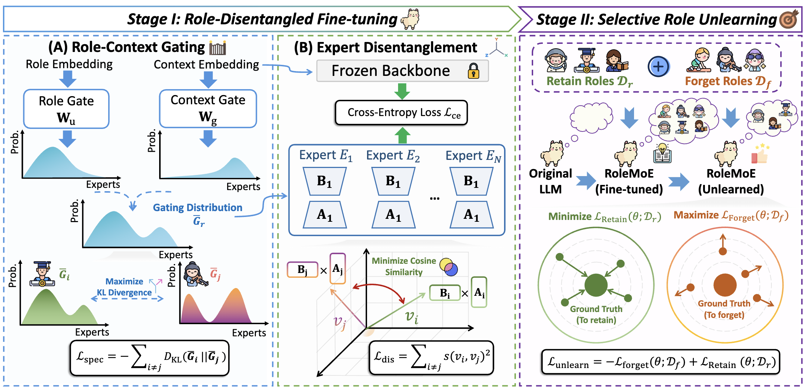

# RoleMoE

<p align="center">
  <a href="https://neurips.cc"></a>
  <a href="LICENSE"></a>
</p>

----

Official repository for the paper:

**From Facts to Personas: Interpretable Role Unlearning in LLMs via Mixture-of-Experts**



LLMs are widely adopted in multi-role dialogue and persona simulation. However, their strong ability to imitate role-specific linguistic and behavioral patterns can introduce privacy risks, reinforce social biases, and lead to unsafe or uncontrollable outputs. To address these issues, we introduce the Role-playing Unlearning task, which aims to selectively forget the style and knowledge associated with target roles while preserving the language ability and behaviors of the remaining roles. Unlike prior unlearning tasks that focus solely on removing factual information, our task additionally requires forgetting persona-specific characteristics, making the control over model generation more fine-grained. We propose ROLEMOE, a Mixture-of-Experts framework that maps different roles to more independent expert subspaces, improving role separation and structural interpretability. To further distinguish role-specific features, ROLEMOE incorporates two complementary losses: a specialization loss that drives roles to adopt distinct expert distributions, and a disentanglement loss that encourages experts to develop distinct capability subspaces. This decomposed structure enables role unlearning to focus selectively on target-role experts. We finally propose RoleBench-Unlearn for evaluation, and experiments on multiple backbone LLMs show that ROLEMOE enables precise and controllable role forgetting, while better preserving the linguistic quality, knowledge, and persona consistency of non-target roles.

## Repository Layout

```text
datasets/       RoleBench-Unlearn data and role descriptions
figs/           Figures used in the paper and README
peft/           Role-play MoE LoRA layer
transformers/   Modified LLaMA modeling code with MoE routing
finetune.py     Stage I: role-disentangled fine-tuning
unlearn.py      Stage II: selective role unlearning
inference.py    Generation and optional LLM-as-judge evaluation
```

## Benchmark Data

RoleBench-Unlearn is organized as follows:


| File                              | Split            | Examples | Roles |
| --------------------------------- | ---------------- | -------- | ----- |
| `datasets/retention_set.json`     | Retention (train) | 1,300    | 13    |
| `datasets/forget_set.json`        | Forget           | 200      | 2     |
| `datasets/retention_testset.json` | Retention (test)  | 200      | 13    |
| `datasets/desc.json`              | Role descriptions | 95 roles | -     |


Each example contains `instruction`, `role`, and `output`:

```json
{
  "instruction": "Your question here",
  "role": "Role Name",
  "output": "Expected response"
}
```

`desc.json` maps each role name to its description text.

## Setup

```bash
pip install -r requirements.txt
```

Flash Attention 2 is optional and speeds up training:

```bash
pip install flash-attn --no-build-isolation
```

RoleMoE expects a local Hugging Face model path. In the examples below, replace `MODEL_PATH` with the target backbone path.

## Stage I: Role-Disentangled Fine-tuning

```bash
python finetune.py \
  --train_input_json_file datasets/retention_set.json \
  --model_name MODEL_PATH \
  --output_dir outputs/stage1 \
  --role_diversity_loss_coef COEF
```

## Stage II: Selective Role Unlearning

```bash
python unlearn.py \
  --model_name MODEL_PATH \
  --pretrained_model_path outputs/stage1 \
  --output_dir outputs/stage2 \
  --config_file unlearn_config.yaml
```

The config file is a YAML file. `loss_type` supports `ga` (gradient ascent) and `gradDiff` (gradient difference):

```yaml
loss_type: gradDiff
learning_rate: 1e-5
epochs: 5
alpha: 1.0
max_grad_norm: 1.0
warmup_ratio: 0.1
per_device_train_batch_size: 1
gradient_accumulation_steps: 16
```

## Inference

```bash
python inference.py \
  --model_name MODEL_PATH \
  --peft_module outputs/stage2 \
  --evaluation_file datasets/retention_testset.json \
  --max_new_tokens 256 \
  --temperature 0.7 \
  --top_p 0.9 \
  --top_k 20
```

Pass `--openai_api_key` to enable LLM-as-judge evaluation.

## Acknowledgements

We thank the open-source communities behind PyTorch, Hugging Face Transformers, and PEFT, as well as the public data resources that made this benchmark possible.

## License

This project is licensed under the MIT License - see the [LICENSE](LICENSE) file for details.
